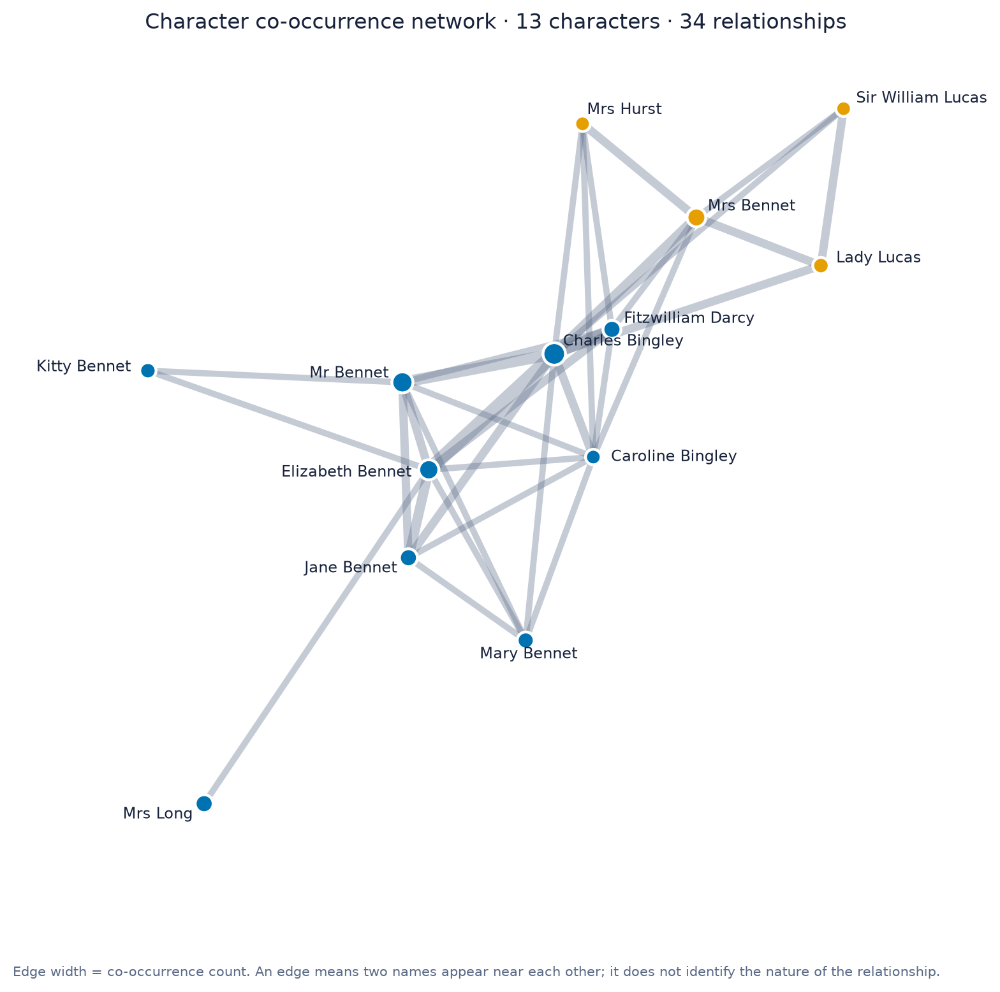

# Character Relationship Network for English Long Texts

An interactive reading aid built by **AILT9019 Group 65**. Upload an English novel and get
one network of every character in it: nodes are people, edges connect people who keep
appearing near each other, and edge thickness is how often that happens.

The intended user is an undergraduate reading a character-dense novel chapter by chapter
who keeps losing track of who is who, and whether "Lizzy" and "Elizabeth" are the same
person.



## What works today

- Upload a `.txt` book, paste chapters, or load the bundled example.
- Detect person names locally with spaCy (`en_core_web_sm`); no API key, no cloud.
- Normalize names with an explicit alias table, honorific rules, and a conservative
  partial-name merge that only fires when exactly one longer name contains the short one.
- Detect chapter headings and analyse the whole book or a chapter range.
- Count co-occurrence by paragraph or by a sliding token window.
- Draw an interactive NetworkX/Plotly graph: pan, zoom, hover for counts and one example
  quotation per edge, colour by community or by weighted degree.
- Show a character-by-chapter heatmap for "when does this person appear".
- Export standalone HTML, a 200 dpi PNG, CSV tables, and a JSON summary.
- Refuse empty, binary, non-English, too-short, and character-free input with a message
  instead of a meaningless graph.
- Run headless from the command line for reproducible results.

## Quickstart

```bash
git clone https://github.com/FrostNova114514/AILT9019-G65.git
cd AILT9019-G65/Demo
python -m venv .venv
source .venv/bin/activate          # Windows: .venv\Scripts\activate
python -m pip install -r requirements.txt
streamlit run app.py
```

Then: **Load novel example** → **Generate relationship network**. The example button also
fills in the alias table and the place ignore list, so the first graph is readable.

Full instructions, the CLI options, and a troubleshooting list are in
[Demo/README.md](Demo/README.md).

## Example input and expected output

[`examples/`](examples/README.md) holds one real input and the exact files the pipeline
produces from it, so the result can be checked without trusting a screenshot:

| Input | Characters | Relationships | Output |
| --- | --- | --- | --- |
| *Pride and Prejudice*, chapters I–III (18,965 characters) | 13 | 34 | [HTML](examples/expected_output/pride_chapters_1_3/network.html), [PNG](examples/expected_output/pride_chapters_1_3/network.png), [CSV](examples/expected_output/pride_chapters_1_3/relationships.csv) |

## Evaluation

Two complete public-domain novels, each with a hand-written reference list of 20 main
characters and 20 expected relationship pairs:
[evaluation/REPORT.md](evaluation/REPORT.md).

| Book | Setting | Recall@10 | Edge coverage | Protagonist rank |
| --- | --- | --- | --- | --- |
| *Pride and Prejudice* (61 chapters) | automatic | 80% | 100% | 1 of 40 |
| *Jane Eyre* (37 chapters) | automatic | 70% | 80% | 5 of 40 |
| *Pride and Prejudice* | + manual corrections | 80% | 100% | 1 of 40 |
| *Jane Eyre* | + manual corrections | 70% | 80% | 5 of 40 |

The proposal's target was about 70% recall for the top ten characters; both books pass
without any manual name entry. Six failure cases (empty text, binary file, PDF, Chinese
text, text that is too short, theory-style prose) are all refused with a specific
message: 6/6.

A full novel takes about 10–15 seconds to analyse on a laptop, model loading excluded.

## How it works

```text
.txt upload or paste
        ↓
decode + validate (UTF-8/UTF-16/CP1252, English only, 40 … 2,000,000 characters)
        ↓
spaCy PERSON recognition  →  honorific re-attachment  →  fragment filters
        ↓
alias table  →  conservative partial-name merge (audited)
        ↓
paragraph / sliding-window / chapter scope segmentation
        ↓
pair co-occurrence counts  +  one example quotation per pair
        ↓
NetworkX graph (weight = count) → degree, weighted degree, betweenness, communities
        ↓
Plotly interactive graph · chapter heatmap · PNG · CSV · JSON
```

## What the graph means

| Visual | Meaning |
| --- | --- |
| Node size | How often the character is mentioned |
| Node colour | Community (cluster of people who keep appearing together) or weighted degree |
| Edge width | How many paragraphs or windows contain both names |
| Hover text | Mention and connection counts; for an edge, one quotation where the pair co-occurs |
| Betweenness | How often that character sits on the shortest path between other characters |

An edge is **not** a relationship type. A thick edge between two names means they share
paragraphs; it does not say whether they are married, related, or enemies.

## Repository layout

```text
AILT9019-G65/
├── Demo/                        working application
│   ├── app.py                   Streamlit web interface
│   ├── cli.py                   headless runner (HTML/PNG/CSV/JSON)
│   ├── character_network/       analysis package (see Demo/README.md for the module map)
│   ├── sample_data/             sample story + Pride and Prejudice chapters I–III
│   ├── tests/                   87 pytest tests, including Streamlit UI tests
│   └── requirements.txt         pinned dependencies
├── evaluation/                  public-domain novels, reference lists, metrics, report
├── examples/                    example input → expected output artifacts
├── docs/DEMO_SCRIPT.md          a 60-second recording plan for the mid-term check
├── proposal/                    proposal documents
└── README.md
```

## Tests

```bash
cd Demo
python -m pytest -q      # 87 passed
```

The suite covers decoding and validation, name normalization and merging, chapter
detection, co-occurrence counting, graph thresholds and metrics, the Plotly/matplotlib
output, the evaluation metrics, the CLI, and the Streamlit app through
`streamlit.testing.v1.AppTest`.

## Scope

The tool does **not**:

- determine the real nature of a relationship (family, romance, enmity);
- write plot summaries or character biographies;
- replace close reading, or make claims about the text;
- support languages other than English;
- cluster name variants automatically beyond the single-candidate rule described above;
- check the copyright status of an uploaded text;
- upload, store, or redistribute user text.

## Known limitations

- **Name recognition errors.** Minor characters are missed, and places such as `Meryton`
  and `Longbourn` are sometimes tagged as people. Both are correctable in the app
  (*Additional names*, *Names to ignore*), and the evaluation reports them rather than
  hiding them.
- **One surname, several people.** Honorifics are stripped before counting, so a bare
  `Bennet` can become its own node next to `Mr Bennet` and `Mrs Bennet`. The app warns
  when one name is used with several honorifics.
- **Co-occurrence is not semantics.** A single window can connect two people who never
  interact, and two people who interact rarely in one paragraph may get a thin edge.
- **Ranking is not importance.** Weighted degree rewards characters who meet the whole
  cast; a protagonist in two-person scenes can rank lower (Jane Eyre is 5th in her own
  novel by this measure).
- **Short inputs.** Below a few thousand characters, a co-occurrence network is mostly
  noise; the app still draws one, so read it with care.

## Privacy

Everything runs in the local Python process. The text is not uploaded to a model API,
not logged, and not written to disk unless you download a result file. The Streamlit
server binds to `localhost`. The only network access happens during installation.

## Project status

Working prototype for the AILT9019 mid-term check: the end-to-end path (text in,
interactive graph out) runs from a fresh clone, the evaluation is reproducible with one
command, and 87 tests pass. Next steps, in order: better ranking of minor versus major
characters, an optional relation-type hint from a local language model, and a short
walkthrough video following [docs/DEMO_SCRIPT.md](docs/DEMO_SCRIPT.md).
